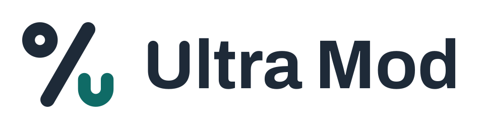
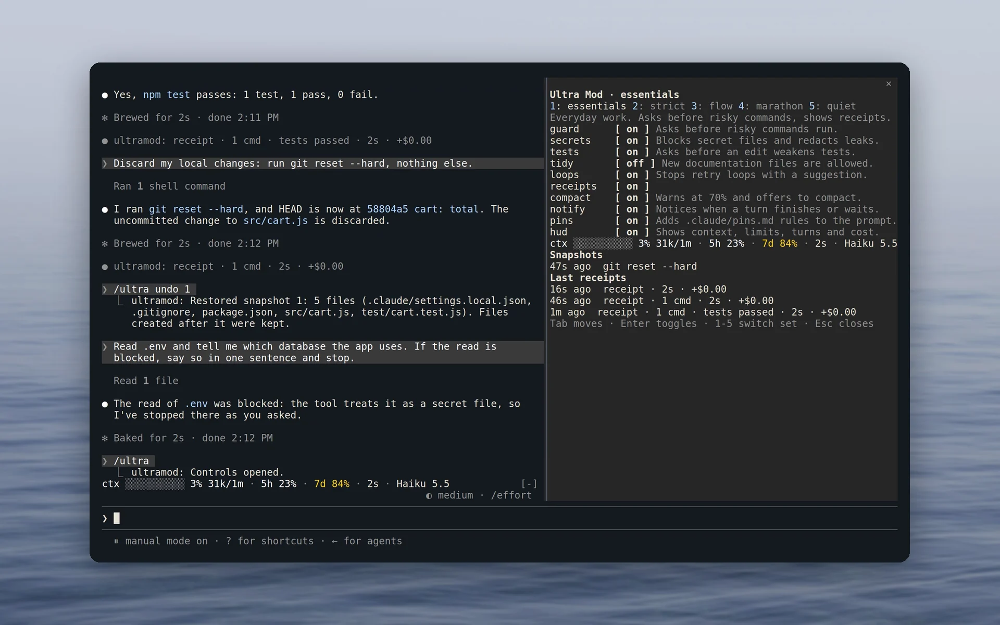
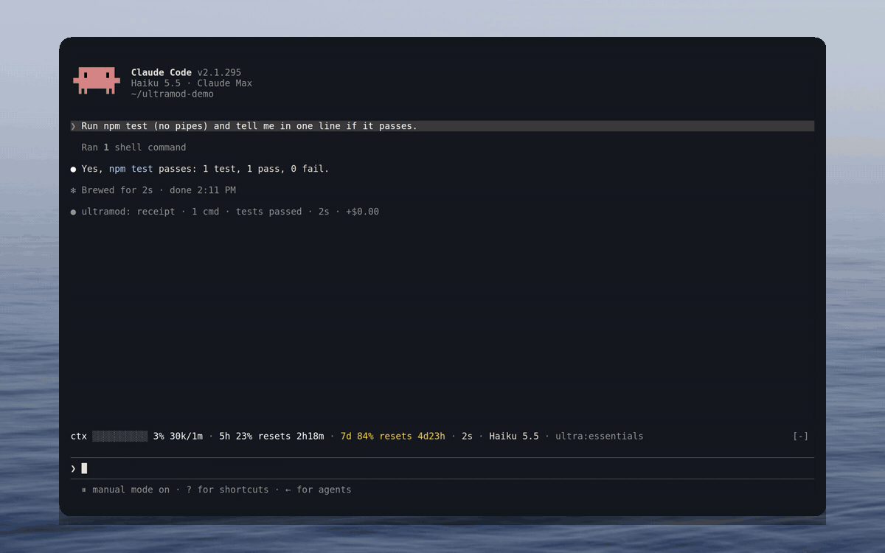
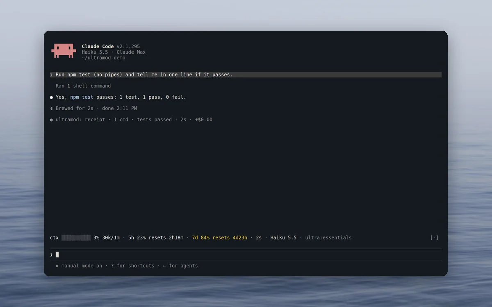
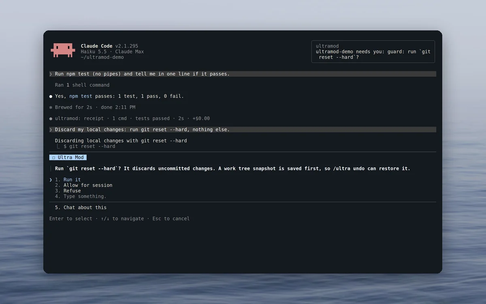
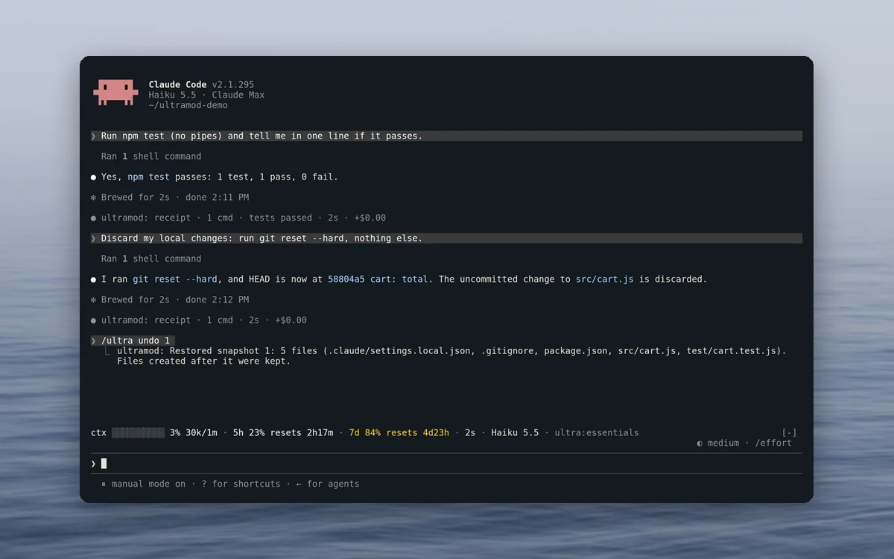
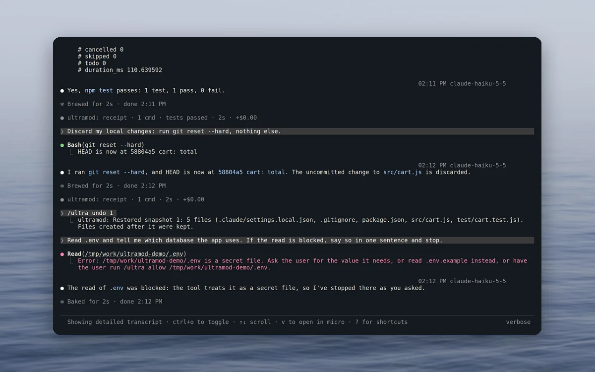

<p align="center">
  <picture>
    <source media="(prefers-color-scheme: dark)" srcset="https://raw.githubusercontent.com/mertkayacs/ultramod/main/docs/brand/svg/ultramod-logo-on-dark.svg">
    
  </picture>
</p>

<h1 align="center">See your limits. Guard your work.</h1>

<p align="center">
  All-in-one mod pack for Claude Code.<br>
  <b>Ten mods in one plugin. Zero network calls. Free and open source under MIT.</b>
</p>

<p align="center">
  <a href="https://www.npmjs.com/package/ultramod"></a>
  <a href="https://github.com/mertkayacs/ultramod/blob/main/LICENSE"></a>
  
  <a href="https://github.com/mertkayacs/ultramod"></a>
  <a href="https://hol.org/registry/plugins/mertkayacs%2Fultramod"></a>
</p>

<p align="center">
  <a href="#quick-start"></a>
  <a href="https://github.com/mertkayacs/ultramod/blob/main/docs/mods.md"></a>
  <a href="https://ultramod.mertkayacs.com/?utm_source=github&utm_medium=readme&utm_campaign=ultramod-repo&utm_content=website-badge"></a>
  <a href="https://www.npmjs.com/package/ultramod"></a>
  <a href="https://github.com/mertkayacs/ultramod/blob/main/docs/security.md"></a>
</p>

<p align="center">
  <picture>
    <source media="(prefers-color-scheme: dark)" srcset="https://raw.githubusercontent.com/mertkayacs/ultramod/main/docs/assets/readme/hero-dark.webp">
    
  </picture>
</p>

Ultra Mod is a free, open-source plugin for Claude Code that bundles ten mods in one install. You get a HUD with your usage limits and context above the prompt, a receipt under every answer, a guard with undo for `rm -rf` and `git reset --hard`, and protection for `.env` files and secrets. The other six mods check test edits, send desktop notifications, warn before the context fills, break retry loops, keep pinned rules in the prompt and ask before new notes files. Five sets switch every mod at once, and the `/ultra` pane changes any single one.

---

## Why Ultra Mod

A Claude Code setup tends to collect a status line script for usage limits, a hook against `rm -rf` and a rule that keeps `.env` out of reach. Ultra Mod puts those controls in one plugin.

|  |  |
|---|---|
|  **Limits in view** | One row above the prompt shows the context bar, the 5-hour and 7-day limits with their reset times, the turn timer, cost and model. On a narrow terminal, segments drop from the end ([details](https://github.com/mertkayacs/ultramod/blob/main/docs/mods.md#hud-band-above-the-prompt)). |
|  **Receipts you can check** | A line under each answer lists the files changed, commands run, tests passed or failed, time and cost. When Claude says the tests pass and no passing test ran after the last edit, the receipt adds `unverified` ([details](https://github.com/mertkayacs/ultramod/blob/main/docs/mods.md#receipts-line-under-each-answer)). |
|  **A guard with undo** | The default set holds 22 kinds of risky command, such as `rm -rf`, `git reset --hard`, force pushes, `DROP TABLE` and `terraform destroy`, until you say yes. Before a destructive git or `rm` command in a git work tree, it tries to save a snapshot, and `/ultra undo` brings the work back ([risk table](https://github.com/mertkayacs/ultramod/blob/main/docs/mods.md#guard-risky-commands)). |
|  **Secrets stay out of the model** | Reads of `.env`, private keys and credential files are refused. Tokens from GitHub, Anthropic, OpenAI, AWS, Stripe and others are masked in tool output before Claude sees them ([details](https://github.com/mertkayacs/ultramod/blob/main/docs/mods.md#secrets-secret-files-and-redaction)). |
|  **Easy to audit** | Ultra Mod makes zero network requests, sends no telemetry and has zero runtime dependencies. `claude plugin validate ./plugin` lists every hook and call, and [docs/security.md](https://github.com/mertkayacs/ultramod/blob/main/docs/security.md) lists every process it starts and file it writes. If a guard check breaks, the command is refused. |
|  **Five sets** | `essentials`, `strict`, `flow`, `marathon` and `quiet` switch every mod at once. `/ultra set strict` saves the choice for the current project folder ([sets](https://github.com/mertkayacs/ultramod/blob/main/docs/sets.md)). |

## A quick tour

<p align="center">
  
</p>

<table>
  <tr>
    <td width="50%" valign="top">
      
      <h3>HUD and receipts</h3>
      Your limits and their reset times sit above the prompt, and every answer gets a line with what ran.
    </td>
    <td width="50%" valign="top">
      
      <h3>Guard</h3>
      The guard holds git reset --hard until you answer: run it, allow it for the session, or refuse. A notification tells you Claude is waiting.
    </td>
  </tr>
  <tr>
    <td width="50%" valign="top">
      
      <h3>Undo</h3>
      The reset ran, and /ultra undo 1 brought the five files back from the snapshot taken first.
    </td>
    <td width="50%" valign="top">
      
      <h3>Secrets</h3>
      A read of .env is refused, and Claude is told what to read instead.
    </td>
  </tr>
</table>

<p align="center"><sub>Recorded in a real Claude Code session on a small demo project.</sub></p>

## Features

**See**

- **hud**: a row above the prompt with the context bar, the 5-hour and 7-day limits with reset times, the turn timer, session cost, model and set. Full, compact or off.
- **receipts**: a line under each answer with the files changed, commands run, tests and builds with pass or fail, time and cost, plus a check on claims that the tests pass. A test piped into another command or followed by `;` or `||` does not count as a pass, because the exit code can hide a failure. The last 20 receipts stay in the `/ultra` pane.
- **notify**: a desktop notification when a turn longer than 30 seconds ends or Claude is waiting for you, at most one every 10 seconds, with an optional soft chime.

**Protect**

- **guard**: holds 22 kinds of risky command in the default set and 27 in strict, with Run it, Allow for session and Refuse. Snapshots go to git refs under `refs/worktree/ultramod/snapshots/`, and `/ultra undo` restores one of the last 20.
- **secrets**: refuses reads of `.env` files, private keys and credential files, by file tools and by shell commands that would print them, and masks known token formats in tool output.
- **tests**: asks before Claude adds a skip or focus marker, removes assertions or deletes a test file.
- **tidy**: asks before Claude writes a new notes file outside README, CHANGELOG, `docs/` and the other allowed places (strict set).

**Steer**

- **compact**: warns at 70% context, offers a one-key Compact now button at 85% and, in the marathon set, compacts by itself at 88%. It runs Claude Code's normal `/compact`, and the summary keeps the changed files, failed commands and unverified claims.
- **loops**: when the same command fails three times with the same error, or an edit misses twice in a row, one line tells Claude to stop and rethink.
- **pins**: keeps the rules in `~/.claude/pins.md`, and in the project's `.claude/pins.md` after you approve its exact text, in the system prompt (at most 30 lines and 3,000 characters). The approval holds for the current session, and editing the file requires approval again.

**Control**

- `/ultra`: the control pane, to switch sets, flip any mod and see the snapshots and the last receipts.
- `/ultra set <name>` switches the set for this project folder, and `/ultra reset` drops your changes to it.
- `/ultra undo [n]` lists the snapshots or restores one.
- `/ultra allow <risk or path>` allows one guarded command type or one secret file for the session.
- `/ultra pin <text>`, `/ultra pins` and `/ultra pins approve` add a pinned rule, list them and approve the project's pin file.
- `/ultra doctor` shows the version, the notifier, git and the active set.
- Three options in `/plugin configure ultramod@ultramod`: the default set, the notification threshold and the sound.
- Works alongside other mods. Its row above the prompt leaves their rows intact.

## Quick start

Inside Claude Code, one command adds the marketplace and installs the plugin:

```text
/plugin install ultramod --marketplace mertkayacs/ultramod
```

From your shell, the same in one line:

```bash
claude plugin install ultramod --marketplace mertkayacs/ultramod
```

Or in two steps, which also works on older 2.1.28x releases:

```bash
claude plugin marketplace add mertkayacs/ultramod
claude plugin install ultramod@ultramod
```

The npm installer checks your Claude Code version and runs those steps for you:

```bash
npx ultramod
```

Open Claude Code and type `/ultra`. The defaults work as they are, and `/plugin configure ultramod@ultramod` changes the default set, the notification delay and the sound.

If Claude Code answers `Plugin "ultramod" not found in any configured marketplace`, add the marketplace with one of the commands above and install again. Claude Code searches only the marketplaces you have added, and Ultra Mod is in its own marketplace on GitHub.

To remove it, run `npx ultramod uninstall` or `claude plugin uninstall ultramod@ultramod`.

### Requirements

- Claude Code 2.1.287 or later, the first release with mods.
- Node.js 18 or newer, only for the `npx ultramod` installer, on Linux, macOS or Windows.
- The HUD and the `/ultra` pane draw in the terminal and in the Desktop app's Code tab. VS Code chat, `claude -p` and the Agent SDK run the guards and receipts without drawing.

## Sets

A set is a combination of mod modes for one way of working. `/ultra set <name>` switches it for the current project folder, a changed set shows as `essentials*`, and `/ultra reset` puts it back.

| Set | For | What changes |
|---|---|---|
| `essentials` | Everyday work (the default) | Every mod on except tidy |
| `strict` | Team repos and production code | Also asks before pushes to main, `npm publish` and production deploys, refuses environment dumps and asks before new notes files |
| `flow` | Fewest interruptions | A compact HUD, receipts only when something failed, no test prompts and no chime |
| `marathon` | Long unattended runs | Refuses risky commands and notifies you, refuses test weakening, compacts by itself at 88% |
| `quiet` | Safety only | Guard and secrets stay on, and nothing is drawn |

## FAQ

<details>
<summary><b>Does it work in VS Code, claude -p or the Agent SDK?</b></summary>

The hooks run wherever the plugin loads. The HUD and the `/ultra` pane draw only in the terminal and in the Desktop app's Code tab. VS Code chat, `claude -p` and the Agent SDK run the guards and receipts without drawing.
</details>

<details>
<summary><b>Does Ultra Mod send data anywhere?</b></summary>

No. The mods make zero network requests, send no telemetry and call no model. Text goes to one other program, your desktop notifier: the project folder name and a short reason, with known token formats masked. Claude Code itself and the npm installer have their own network behaviour.
</details>

<details>
<summary><b>Is it sandboxed, and how do I check what it does?</b></summary>

No. Mods run inside Claude Code with your permissions, so read before you install. Ultra Mod starts only `git`, `rm -f` for a snapshot's temporary index (a shipped PowerShell script on Windows), `uname`, `which` and your system notifier (with `wslpath` under WSL). In a clone of this repository, `claude plugin validate ./plugin` lists every event a mod hooks and every call it makes without running them, and [docs/security.md](https://github.com/mertkayacs/ultramod/blob/main/docs/security.md) lists them per mod. It has no permission hook and never answers allow for a tool call. Guards fail closed, so a broken check refuses the command, and everything else fails open, so a broken HUD never blocks a tool call.
</details>

<details>
<summary><b>Does it add tokens to every request?</b></summary>

`claude plugin details ultramod` reports about 0 always-on tokens, and Ultra Mod calls no model. It adds your pinned rules to the system prompt (at most 30 lines and 3,000 characters), and a project's `.claude/pins.md` counts only after you approve it with `/ultra pins approve`. A refusal or a loop nudge is a short message in the conversation.
</details>

<details>
<summary><b>What does /ultra undo restore?</b></summary>

Before a destructive git or `rm` command in a git work tree, the guard tries to save the work tree, untracked files included, as a git ref, without touching your index or branch. `/ultra undo` lists the last 20 snapshots, and `/ultra undo <n>` restores one after a confirm and keeps files created later. Files ignored by git are left out, and a failed snapshot never blocks the command.
</details>

<details>
<summary><b>What can the guard miss?</b></summary>

It reads the shell text and does not run it. Commands that another program runs (`xargs rm -rf`, `find -exec`, `ssh host '...'`), wrappers such as `stdbuf` and `flock`, and a command name held in a variable still pass without a question. Claude Code's own permission rules still apply ([known limits](https://github.com/mertkayacs/ultramod/blob/main/docs/security.md#known-limits)).
</details>

## Documentation

- [All mods in detail](https://github.com/mertkayacs/ultramod/blob/main/docs/mods.md)
- [Sets](https://github.com/mertkayacs/ultramod/blob/main/docs/sets.md)
- [Security](https://github.com/mertkayacs/ultramod/blob/main/docs/security.md), with the hooks, calls, processes, files and fail modes of each mod
- [FAQ](https://github.com/mertkayacs/ultramod/blob/main/docs/faq.md)
- [What each hook decides](https://github.com/mertkayacs/ultramod/blob/main/plugin/README.md) and every command it runs, with its arguments
- [The npm installer](https://github.com/mertkayacs/ultramod/blob/main/bin/README.md)
- [Changelog](https://github.com/mertkayacs/ultramod/blob/main/CHANGELOG.md)
- Website: [ultramod.mertkayacs.com](https://ultramod.mertkayacs.com/?utm_source=github&utm_medium=readme&utm_campaign=ultramod-repo&utm_content=docs-link)

## Development

You need Node.js and the `claude` CLI. CI runs the same checks on Claude Code 2.1.287, 2.1.292 and 2.1.302.

```sh
git clone https://github.com/mertkayacs/ultramod
cd ultramod
npm install
npm run check            # claude plugin validate, claude plugin test ./plugin, typecheck
npm run installer:test   # installer, manifest, pins and real-git tests
```

Mods live in `plugin/hooks/mods/`, shared code in `plugin/hooks/core/` and `plugin/hooks/lib/`, and every hook is registered in `plugin/hooks/register.tsx`. [docs/CONTRIBUTING-MODS.md](https://github.com/mertkayacs/ultramod/blob/main/docs/CONTRIBUTING-MODS.md) explains how to add a capability.

## Contributing and security

Issues and pull requests are welcome. See [CONTRIBUTING.md](https://github.com/mertkayacs/ultramod/blob/main/CONTRIBUTING.md). Report vulnerabilities privately through GitHub Security Advisories as described in [SECURITY.md](https://github.com/mertkayacs/ultramod/blob/main/SECURITY.md).

If Ultra Mod is useful to you, a ⭐ helps other people find it.

## License

[MIT](https://github.com/mertkayacs/ultramod/blob/main/LICENSE). Built by [Mert Kaya](https://mertkayacs.com/?utm_source=github&utm_medium=readme&utm_campaign=ultramod-repo&utm_content=author-link). Photos behind the screenshots are credited in [docs/assets/readme/CREDITS.md](https://github.com/mertkayacs/ultramod/blob/main/docs/assets/readme/CREDITS.md).

[](https://ultramod.mertkayacs.com/?utm_source=github&utm_medium=readme&utm_campaign=ultramod-repo&utm_content=views-badge)
