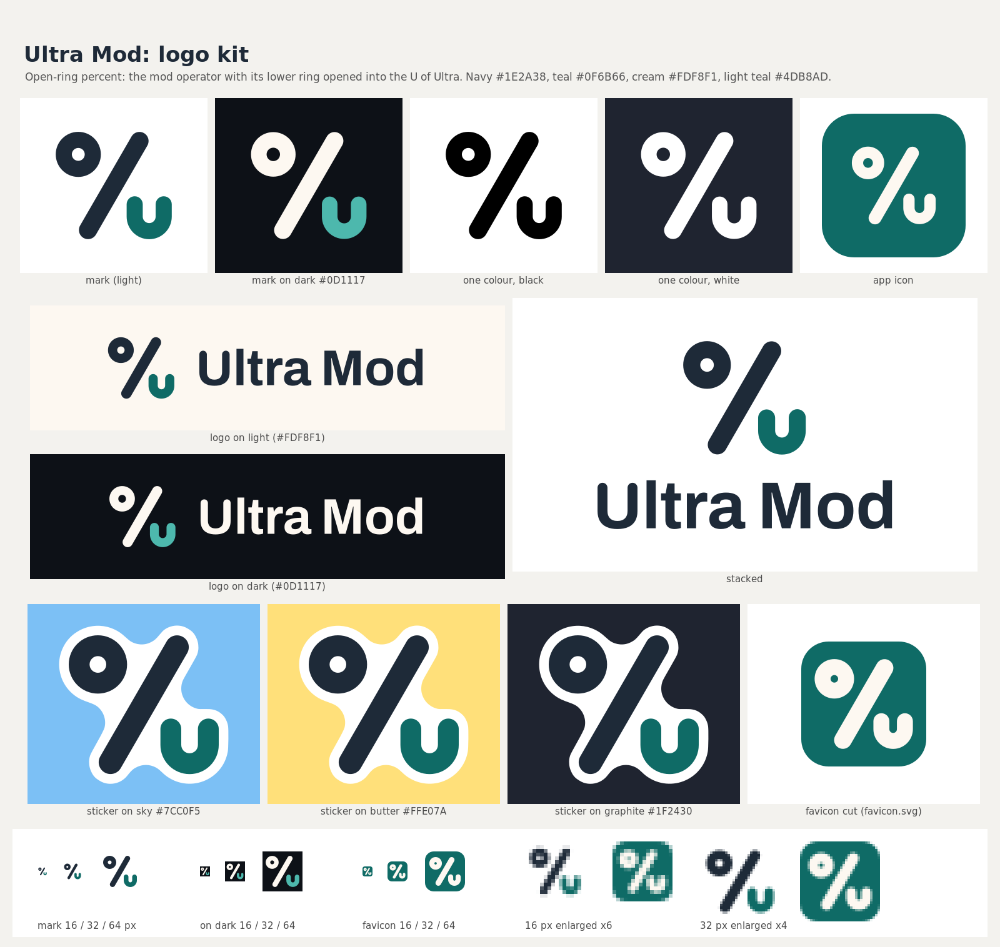

# Ultra Mod logo kit

**The idea:** a percent sign, the mod operator in TypeScript, with its lower ring opened into the U of Ultra.
The band Ultra Mod draws above the prompt reads in percents (`ctx 3%`, `5h 22%`), so the sign belongs to the
product as well as to the name.



## Files

| File | Use |
|---|---|
| `svg/ultramod-mark.svg` | Colour mark for light grounds (navy percent, teal U), 256 square |
| `svg/ultramod-mark-on-dark.svg` | Colour mark for dark grounds (cream percent, light teal U), drawn 3 % thinner |
| `svg/ultramod-mark-black.svg`, `svg/ultramod-mark-white.svg` | One colour. The white file uses the thinner cut |
| `svg/ultramod-sticker.svg` | Mark with a white die-cut border, 14 units out from the mark (about 6 % of its width), rounded |
| `svg/ultramod-logo-on-light.svg`, `svg/ultramod-logo-on-dark.svg` | Horizontal lockup, 256 tall |
| `svg/ultramod-logo-stacked.svg` | Mark above the wordmark, for square spaces |
| `svg/ultramod-appicon.svg` | Cream mark on a teal rounded tile, 1024 canvas, mark 600 wide |
| `png/` | `mark-1024`, `logo-on-light-1600`, `logo-on-dark-1600`, `appicon-1024`, `sticker-512`, all transparent outside the artwork |
| `favicon/` | `favicon.svg` (heavier small-size cut on the teal tile), `favicon.ico` (16, 32, 48), `favicon-32.png`, `apple-touch-icon.png` (180, full bleed), `icon-192.png`, `icon-512.png`, `icon-maskable-512.png` (full bleed, mark inside the 80 % safe circle) |
| `work/` | Build intermediates: the full-bleed icon, the small-cut mark, and the skill's `export_variants.py` output with a `site.webmanifest` |

The SVGs in `svg/` and `favicon/` are flat filled paths: no live text, rasters, filters, masks, gradients,
strokes or transforms (the reference files in `work/export` keep the exporter's wrapper transforms). Every PNG
was rendered from its SVG with rsvg-convert.

## Colours

Contrast is the WCAG 2.x ratio, measured with `../tools/contrast.py`.

| Colour | HEX | Role | on `#FFFFFF` | on `#FDF8F1` | on `#0D1117` |
|---|---|---|---|---|---|
| Navy | `#1E2A38` | Percent and wordmark on light grounds | 14.55 | 13.77 | 1.30 |
| Teal | `#0F6B66` | The U on light grounds, the app icon tile | 6.33 | 5.99 | 2.99 |
| Cream | `#FDF8F1` | Percent and wordmark on dark grounds, the mark on the teal tile | 1.06 | 1.00 | 17.91 |
| Light teal | `#4DB8AD` | The U on dark grounds | 2.39 | 2.26 | 7.91 |

Navy and teal are for light grounds only; cream and light teal are for dark grounds only. On graphite `#1F2430`
cream measures 14.69 and light teal 6.48, and cream on the teal tile measures 5.99.

## Clear space

Leave free space on every side equal to the ring's outer radius: 42 units on the 256-unit mark, about a fifth of
the mark's width. On the horizontal logo at 256 px tall that is 35 px.

## Minimum sizes (screen, tested)

- Mark: 16 px. Below 32 px use `favicon/favicon.svg`, the heavier cut on the teal tile. The U shows from 24 px; at
  16 px the mark reads as a percent sign.
- Horizontal logo: 24 px tall (90 px wide). It stays legible at 20 px.
- Stacked logo: 64 px tall. It stays legible at 48 px.

Print sizes have not been proofed yet, so check a test print before a small print run.

## Typography

The wordmark is Archivo by Omnibus-Type, under the SIL Open Font License 1.1 ("Copyright 2020 The Archivo Project
Authors"), downloaded from google/fonts (`ofl/archivo`). The licence text is in `../fonts/Archivo-OFL.txt`. It is
set at weight 700 and width 100 on light grounds and at weight 680 on dark grounds, because light type on a dark
ground looks heavier. The U of "Ultra" carries the round terminals of the U in the mark. All letters are outlined,
so no font is needed to show the logo; for running text next to it, Archivo itself is the natural partner.

## Do

- Use the `-on-dark` files on `#0D1117`, `#1F2430` and navy.
- Put the white one-colour mark on the teal brand colour and on dark photos.
- Keep the white die-cut border whenever the mark is used as a sticker.
- Use `favicon.svg` for tabs and other spots under 32 px.

## Don't

- Put the light mark on a dark ground: the navy percent disappears.
- Set the teal U on a teal ground.
- Rotate or mirror the mark, or change the slash's 60° angle.
- Close the U, move it, or swap which ring is open.
- Add outlines, shadows, glows or gradients (the sticker border is the one outline).
- Retype "Ultra Mod" in another font or weight.

## Web head snippet

```html
<link rel="icon" href="/favicon.ico" sizes="48x48">
<link rel="icon" href="/favicon.svg" type="image/svg+xml">
<link rel="apple-touch-icon" href="/apple-touch-icon.png">
```

For a web manifest, list `icon-192.png` and `icon-512.png`, and `icon-maskable-512.png` with
`"purpose": "maskable"`.
